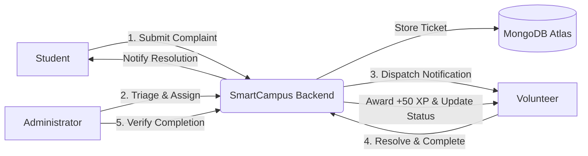

# 🏛️ SmartCampus Management System

[](https://fastapi.tiangolo.com)
[](https://react.dev)
[](https://vitejs.dev)
[](https://www.mongodb.com)
[](https://jwt.io)
[](LICENSE)

An end-to-end, gamified civic technology platform purpose-built for universities and educational institutions. **SmartCampus Management** bridges students, student volunteers, and university leadership into a unified digital operating system for real-time grievance redressal, transparent issue tracking, and community engagement.

---

## 🌟 Why SmartCampus?

In traditional campus setups, daily operational issues—such as broken water dispensers, classroom IT failures, unhygienic hostel conditions, and electrical faults—get buried in paper registers or informal chat groups. 

**SmartCampus solves this permanently:**
- **⚡ 4x Faster Resolution:** Direct assignment of nearby student volunteers cuts resolution times from days to hours.
- **🔄 100% Audit Transparency:** Real-time 4-stage pipeline (`Pending` &rarr; `Assigned` &rarr; `Completed` &rarr; `Verified`).
- **🏆 Gamified Community Service:** Volunteers earn **+50 XP** per verified resolution, unlocking prestige university tiers (**Bronze**, **Silver**, **Gold**, **Platinum**).
- **🛡️ Single Source of Truth:** Centralized analytics and command center for university administrators.

---

## 🏗️ System Architecture



### 4-Stage Resolution Pipeline

| Stage | Status Badge | Trigger | Description |
| :--- | :--- | :--- | :--- |
| **1. Report** | `🟡 Pending` | Student | Issue submitted with photo, location, category & priority in <30 seconds. |
| **2. Triage** | `🔵 Assigned` | Admin | Administrator assigns ticket to an active student volunteer. |
| **3. Field Work** | `🟠 Completed` | Volunteer | Volunteer inspects site, resolves the issue, and marks task complete. |
| **4. Verification** | `🟢 Verified` | Admin | Admin inspects resolution, closes ticket, and credits **+50 XP** to the volunteer. |

---

## 👥 Three Stakeholder Roles

### 🎓 1. For Students (Campus Citizens)
- **Fast Submission:** 30-second complaint filing with photo attachments, location, and severity level.
- **10 Campus Categories:** Infrastructure, Sanitation, IT/Technology, Campus Safety, Academics, Hostels, Canteen, Transport, Sports, and General.
- **Live Tracking:** Real-time status indicators and detailed timestamps.
- **In-App Notifications:** Automatic alerts when an issue is picked up, in progress, or verified.

### 🤝 2. For Volunteers (Civic Change-Makers)
- **Task Queue:** Clear list of assigned campus tasks with deadlines and location specifics.
- **One-Tap Completion:** Mark field tasks resolved directly from mobile or desktop.
- **Gamification Engine:**
  - 🥉 **Bronze Volunteer:** 100 – 299 XP (2–5 tasks)
  - 🥈 **Silver Volunteer:** 300 – 699 XP (6–13 tasks)
  - 🥇 **Gold Volunteer:** 700 – 1499 XP (14–29 tasks)
  - 💎 **Platinum Legend:** 1500+ XP (University civic leadership honors)
- **Service Portfolio:** Verified record of volunteer service hours for CVs and institutional recognition.

### 🛡️ 3. For Administrators (Facilities & Leadership)
- **Central Command Board:** Live overview of campus health, unresolved tickets, and volunteer loads.
- **Smart Triage:** Search & filter complaints by status, category, date, and priority.
- **One-Click Verification:** Verify volunteer work and automatically award XP points.
- **Analytics Dashboard:** Monthly trend charts, category breakdown heatmaps, and volunteer leaderboards.

---

## 🎨 Visual Identity & Theme System

- **Primary Colors:** Crimson Depth (`#710014`), Warm Sand (`#B38F6F`), Soft Pearl (`#F2F1ED`), and Obsidian Black (`#161616`).
- **Light Mode Surface:** Warm Ivory/Beige (`#EDE8D0`).
- **Typography:** Playfair Display for editorial serif headings; DM Sans for clean UI body.
- **Responsive:** Mobile-first layout with touch-friendly controls and smooth dark/light mode toggle.

---

## 📁 Repository Structure

```
SmartCampus-Management/
├── backend/
│   ├── app/
│   │   ├── dependencies/      # Auth & RBAC dependencies
│   │   ├── models/            # Database document models
│   │   ├── routers/           # Auth, complaints, volunteer, admin, notifications
│   │   ├── schemas/           # Pydantic validation schemas
│   │   ├── services/          # Business logic services
│   │   ├── utils/             # JWT, security, badges, notifications
│   │   ├── database.py        # MongoDB connection setup
│   │   ├── config.py          # Environment settings
│   │   └── main.py            # FastAPI application entrypoint
│   ├── uploads/               # Complaint image storage directory
│   ├── requirements.txt       # Python dependencies
│   ├── .env.example           # Backend environment template
│   └── README.md              # Backend documentation
│
├── frontend/
│   ├── public/
│   │   ├── campus-bg.jpg      # High-res university hero background
│   │   └── favicon.svg        # SmartCampus architectural emblem
│   ├── src/
│   │   ├── components/        # Modals, layout (Sidebar, Header), badges, logos
│   │   ├── context/           # AuthContext & ThemeContext
│   │   ├── hooks/             # useNotifications & useToast
│   │   ├── pages/             # Auth (Login, Register), Student, Volunteer, Admin
│   │   ├── routes/            # ProtectedRoute with RBAC guards
│   │   ├── services/          # Axios API service module
│   │   ├── utils/             # Helper formatters & constants
│   │   ├── App.jsx            # Application routing definitions
│   │   └── index.css          # Global SmartCampus CSS design system
│   ├── package.json           # Frontend dependencies
│   ├── vite.config.js         # Vite configuration
│   └── .env.example           # Frontend environment template
│
├── .gitignore                 # Monorepo git ignore rules
└── README.md                  # Project master documentation
```

---

## 🚀 Quickstart Guide

### Prerequisites
- **Python:** 3.10 or higher
- **Node.js:** 18.0 or higher (npm included)
- **MongoDB:** Local instance or [MongoDB Atlas](https://www.mongodb.com/atlas) cloud cluster

---

### 1. Backend Setup

```bash
# Navigate to backend directory
cd backend

# Create and activate a virtual environment
python -m venv venv

# Windows:
.\venv\Scripts\activate
# macOS/Linux:
source venv/bin/activate

# Install dependencies
pip install -r requirements.txt

# Configure environment variables
cp .env.example .env
```

Edit `.env` with your MongoDB connection string and secret key:
```env
MONGODB_URI=mongodb+srv://<username>:<password>@cluster0.example.mongodb.net/smartcampus?retryWrites=true&w=majority
SECRET_KEY=your_super_secret_jwt_key_here
ALGORITHM=HS256
ACCESS_TOKEN_EXPIRE_MINUTES=60
```

Start the FastAPI development server:
```bash
uvicorn app.main:app --reload --port 8000
```
- API Documentation (Swagger UI): `http://localhost:8000/docs`
- Health Check: `http://localhost:8000/`

---

### 2. Frontend Setup

```bash
# Navigate to frontend directory
cd frontend

# Install dependencies
npm install

# Configure environment variables
cp .env.example .env
```

Ensure `.env` points to your backend instance:
```env
VITE_API_URL=http://localhost:8000
```

Start the Vite development server:
```bash
npm run dev
```
Open your browser at `http://localhost:5173` (or `http://localhost:5174`).

---

## 🔌 API Endpoints Reference

| Method | Endpoint | Description | Access |
| :--- | :--- | :--- | :--- |
| `POST` | `/register` | Register new Student or Volunteer account | Public |
| `POST` | `/login` | Authenticate & retrieve OAuth2 Bearer JWT | Public |
| `GET` | `/me` | Get currently authenticated user profile | Authenticated |
| `POST` | `/complaints` | File a new complaint with category & location | Student |
| `GET` | `/complaints` | List current student's complaints | Student |
| `GET` | `/volunteer/tasks` | Get tasks assigned to the current volunteer | Volunteer |
| `PUT` | `/volunteer/tasks/{id}/complete` | Mark assigned task completed | Volunteer |
| `GET` | `/volunteer/dashboard` | Get volunteer stats, XP progress & badge | Volunteer |
| `GET` | `/admin/complaints` | Get all campus complaints across all blocks | Admin |
| `PUT` | `/admin/complaints/{id}/assign` | Assign complaint to volunteer | Admin |
| `PUT` | `/admin/complaints/{id}/verify` | Verify complaint & credit +50 XP | Admin |
| `GET` | `/admin/dashboard` | Administrative overview & performance metrics | Admin |
| `GET` | `/notifications` | Get in-app notifications stream | Authenticated |
| `PUT` | `/notifications/read-all` | Mark all notifications as read | Authenticated |

---

## 🛡️ Security & Privacy
- **OAuth2 with Password Bearer & JWT:** Stateless authentication with expiration enforcement.
- **Role-Based Guards (RBAC):** Backend route dependencies prevent unauthorized cross-role access.
- **Password Hashing:** Passwords hashed using bcrypt.
- **Environment Isolation:** Zero credentials committed to version control.

---

## 📄 License
This project is licensed under the [MIT License](LICENSE).
